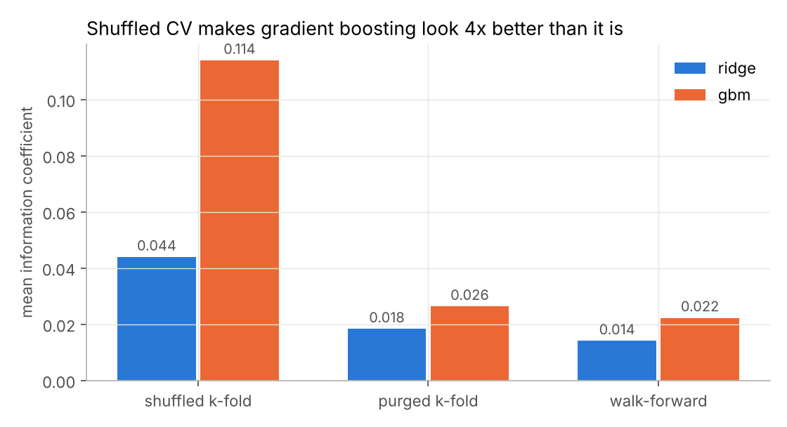
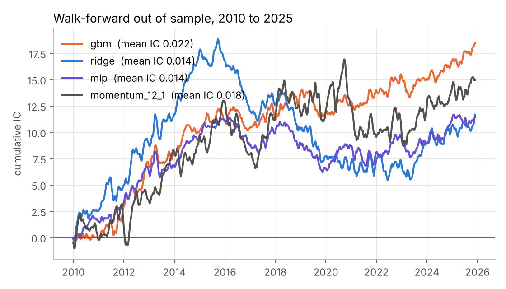
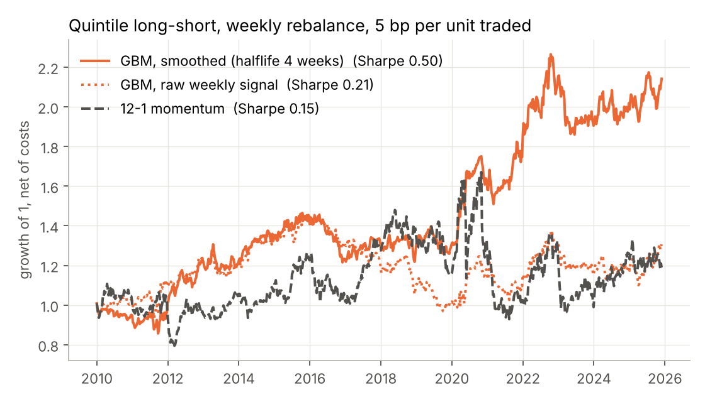
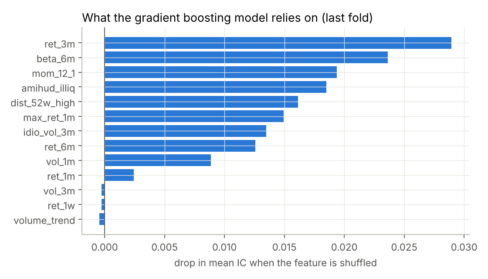

# Predicting stock returns with machine learning, without fooling yourself

[](https://github.com/adrienliao/ml-return-prediction/actions/workflows/tests.yml)


Can a gradient boosting model rank 86 US large caps by their next month return better than the classic factors? A little, yes. But the more useful lesson is how easy it is to believe the answer is "a lot": with the cross validation a generic ML tutorial would use, the same model looks four times better than it really is.

## The setup

* **Data**: daily prices and volumes of 86 US large caps and SPY, 2004 to 2025 (cached in `data/`, so everything runs offline)
* **Samples**: one row per stock per week, 93,780 rows in total
* **Target**: the stock's return over the next 21 trading days, ranked across stocks on each date. Ranking removes the market move, so the model only has to answer "which stocks will do better than the others"
* **13 features**, all computed from data available at the time: past returns over 1 week to 12 months, volatility, beta, idiosyncratic volatility, distance to the 52 week high, max daily return (lottery effect), volume trend and Amihud illiquidity. Each one is ranked across stocks on each date
* **Models**: ridge regression, gradient boosting (scikit-learn `HistGradientBoosting`), a small MLP, and three single factor baselines from the literature (12-1 momentum, 1 month reversal, low volatility)
* **Validation**: expanding window walk-forward, refit every year, with a 5 week purge between training and test so that no training label overlaps a test label. Out of sample period: 2010 to 2025

## Result 1: the validation scheme matters more than the model



Labels are 21 day returns sampled every week, so consecutive labels share three weeks of the same returns. A shuffled K-fold puts in the training set labels that almost contain the test labels, and gradient boosting is flexible enough to exploit it: its information coefficient (IC) jumps from 0.026 to 0.114. Purging the overlapping weeks (López de Prado, ch. 7) brings it back to the walk-forward number. Ridge is less flexible, so it leaks less, but it still looks three times better than it is.

## Result 2: out of sample performance

| Signal | Mean IC | IC t-stat (Newey-West) | Long-short Sharpe, gross | Long-short Sharpe, net of 5 bp | Turnover per year |
| --- | --- | --- | --- | --- | --- |
| **Gradient boosting, smoothed** | **0.023** | **2.5** | **0.58** | **0.50** | 19x |
| Gradient boosting, raw | 0.022 | 2.9 | 0.58 | 0.21 | 78x |
| Ridge | 0.014 | 1.3 | 0.42 | 0.20 | 56x |
| MLP | 0.014 | 1.9 | 0.23 | -0.23 | 86x |
| 12-1 momentum | 0.018 | 1.2 | 0.22 | 0.15 | 25x |
| 1 month reversal | 0.003 | 0.2 | 0.23 | -0.01 | 78x |
| Low volatility | -0.026 | -1.4 | -0.51 | -0.56 | 18x |



* Gradient boosting is the only signal whose IC is statistically significant once the autocorrelation from overlapping labels is accounted for (Newey-West with 4 lags; a naive t-stat would overstate it).
* An IC of 0.02 sounds tiny, but it is in line with what is realistic for cross sectional equity signals. It is the consistency (an IC information ratio of 1.1) that makes it usable.
* The raw signal changes a lot from week to week, so costs eat most of it. **Smoothing the predictions** with an exponential moving average (halflife 4 weeks) keeps the same IC, cuts turnover by 4x and more than doubles the net Sharpe. I tried halflives of 2, 4 and 8 weeks and all three land between 0.41 and 0.50, so this is not a lucky pick.
* Low volatility had a bad run in this universe over this period, with a negative IC throughout.



Most of the smoothed strategy's gain comes from 2020 to 2022, which is a reason to be careful with the headline Sharpe.

## Result 3: what the model uses



Permutation importance on the last fold, shuffling one feature at a time across stocks on each date and measuring how much the IC drops. The model leans on medium term momentum (3 months, 12-1), beta and illiquidity, and essentially ignores the very short term features.

## Code

| File | Content |
| --- | --- |
| `mlalpha/features.py` | Feature engineering, weekly sampling, cross sectional ranking, targets |
| `mlalpha/cv.py` | Walk-forward, purged K-fold and shuffled K-fold splitters on a (date, ticker) panel |
| `mlalpha/models.py` | Model definitions and the single factor baselines |
| `mlalpha/evaluate.py` | IC series, Newey-West t-stat, quintile long-short book with costs |
| `scripts/run_experiments.py` | Runs everything above and writes `results/results.json` and the figures |

Tests check that features never use future data (prices after a cutoff are distorted and nothing before it may change), that targets are exactly the forward excess return, that every split leaves a purge gap between train and test, and that the Newey-West t-stat reduces to the plain one without lags.

## Run it

```bash
pip install -e ".[dev]"
pytest -q
python scripts/run_experiments.py     # about 5 minutes
```

## Limits

The universe is today's large caps that already existed in 2005, so it has **survivorship bias**: no stock in it went bankrupt. 86 names is also a small cross section, which makes quintile portfolios noisy. A serious version would use point in time index membership (CRSP or similar) and fundamental data.

## References

* M. López de Prado (2018), *Advances in Financial Machine Learning*, ch. 7 (purged cross validation)
* S. Gu, B. Kelly, D. Xiu (2020), *Empirical asset pricing via machine learning*, Review of Financial Studies
* W. Newey, K. West (1987), *A simple, positive semi-definite, heteroskedasticity and autocorrelation consistent covariance matrix*
